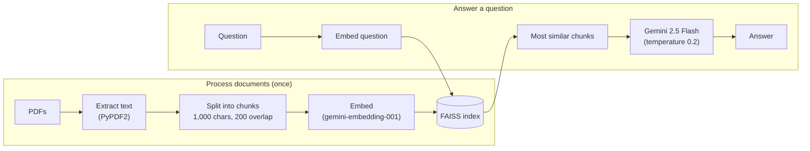

# Multi-PDF Chat: Ask Questions Across Your PDFs

A **Retrieval-Augmented Generation (RAG)** app: upload several PDFs, then ask questions in plain language. Answers come from the content of your documents. The app is built with **LangChain**, **Google Gemini 2.5 Flash**, **Gemini embeddings**, a **FAISS** vector index and **Streamlit**.

## How it works



1. **Extract:** PyPDF2 reads the text from every page of every uploaded PDF.
2. **Chunk:** LangChain's `RecursiveCharacterTextSplitter` splits the text into **1,000-character chunks with a 200-character overlap**, so sentences that cross a boundary appear in both chunks.
3. **Embed and index:** each chunk is turned into a vector with Google's `gemini-embedding-001` model and stored in a **FAISS** index on disk (`faiss_index/`).
4. **Retrieve:** a question is embedded the same way, and FAISS returns the chunks closest in meaning.
5. **Answer:** the retrieved chunks and the question go to **Gemini 2.5 Flash** in a single prompt.

## Keeping answers grounded

The model is told to answer **only from the retrieved context**. If the answer isn't there, it says:

> "I couldn't find the answer in the uploaded documents. Try rephrasing your question or uploading additional documents."

This, together with a low temperature (0.2), cuts down on made-up answers. The model says it doesn't know instead of guessing.

## Features

- Upload and query **several PDFs at once**
- Chat-style history of questions and answers
- Stats after processing: number of documents, pages, chunks and questions asked
- "Clear chat history" button
- Clear error messages, for example when you ask a question before processing any documents

## Project structure

```
Multi-PDF-Chat-App/
├── app.py            # Main app: Streamlit UI and the full RAG pipeline
├── chatapp.py        # Earlier, simpler version (Gemini Pro, 50,000-char chunks), kept for reference
├── test_models.py    # Lists the Gemini models your API key can use
├── docs/             # Sample PDFs to try the app with
└── requirements.txt
```

## Getting started

**Requirements:** Python 3.10+ and a Google Gemini API key (free from [Google AI Studio](https://aistudio.google.com/app/apikey)).

```bash
git clone https://github.com/SANJAY6215/Multi-PDF-Chat-App.git
cd Multi-PDF-Chat-App

python -m venv venv
source venv/bin/activate        # Windows: venv\Scripts\activate

pip install -r requirements.txt
```

Create a `.env` file in the project folder:

```
GOOGLE_API_KEY=your-api-key-here
```

Optionally, check your key and see the available models:

```bash
python test_models.py
```

## Usage

```bash
streamlit run app.py
```

1. Upload one or more PDFs in the sidebar (the `docs/` folder has samples).
2. Click **Process Documents** and wait for the index to build.
3. Type a question in the main panel, for example *"What are the key findings in the report?"*

## Known limitations

- Answers don't say **which file or page** they came from, because text from all PDFs is merged before chunking.
- Scanned PDFs (images of text) produce no text, because PyPDF2 doesn't do OCR.
- Each question is answered on its own; earlier questions in the chat aren't sent to the model as context.
- Processing a new set of PDFs replaces the previous index.
- The app loads the FAISS index with `allow_dangerous_deserialization=True`. That's safe here because it only loads the index it wrote itself, but never point it at an index file from someone else.

## Next steps

- [ ] Store file name and page number with each chunk and show sources under every answer.
- [ ] Add OCR for scanned PDFs.
- [ ] Add conversation memory for follow-up questions.
- [ ] Build a small question-and-answer test set to measure retrieval quality when chunk size or settings change.

## Tech stack

Python · LangChain · Google Gemini 2.5 Flash · Gemini Embeddings · FAISS · PyPDF2 · Streamlit
